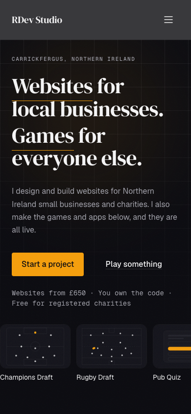
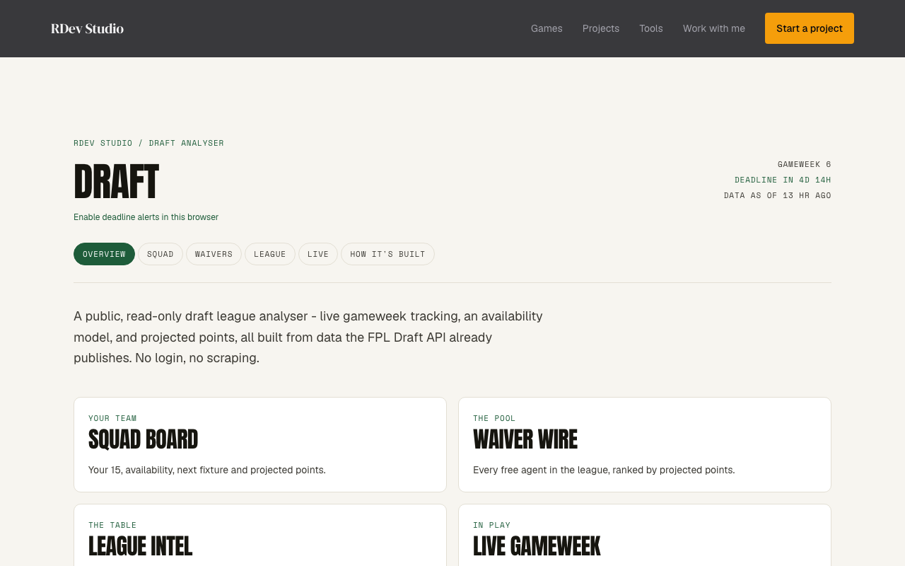
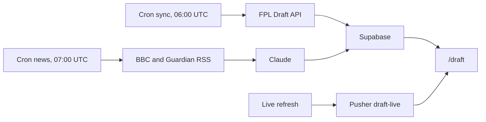

# RDev Studio

A one-person web studio site, plus live games and tools, at [www.rdevstudio.co.uk](https://www.rdevstudio.co.uk).

Next.js 15 App Router, TypeScript, Tailwind, Supabase, Pusher, Upstash Redis, Vercel, Formspree, and the Anthropic API. Node 22.





## What's in here

| Product | Route | The interesting part |
| --- | --- | --- |
| Champions Draft | `/champions-draft` | Squad JSON in `data/champions-draft`. No database. |
| Rugby Draft | `/rugby-draft` | Squad JSON in `data/rugby-draft`. No database. |
| Pub Quiz | `/pub-quiz` | One Pusher channel per game. State in memory, and in Upstash when it is configured. |
| Longest Word | `/games/longest-word` | A 4x4 grid seeded from the date. Words are checked at dictionaryapi.dev. |
| Draft Analyser | `/draft` | Daily crons pull the FPL Draft API into Supabase. Claude reads BBC and Guardian RSS. Pusher pushes the live board. |
| Wardrobe AI | `/wardrobe-ai` | The public page is a teaser until `WARDROBE_LIVE=true`. Tagging and scoring call Anthropic. |
| Toolkit | `/toolkit` | Small graders and generators. A URL audit is fetched on the server. |
| Stout Finder | `/stout-finder` | Redirects to [stoutfinder.com](https://stoutfinder.com). The app is in `rdavidson5637/stoutfinder`. |

Gig Radar and Guitar Lab are on the site and marked soon in `lib/content/products.ts`.

## How the live bits work



Sync and news are the two scheduled jobs in `vercel.json`. Writes use the service role. The page reads through the anon key, and row level security on the FPL tables is select-only. Live points are broadcast on the `draft-live` channel when something calls `/api/cron/live` or the board's refresh route.

A pub quiz room is a Pusher channel named `game-{id}`. The server keeps that game in a memory map, and also writes it to Upstash (`lib/quiz/kv-store.ts`) when `KV_REST_API_URL` or `UPSTASH_REDIS_REST_URL` is set. The key lasts four hours. With no Redis, the game only lives in that process.

## Decisions

- Server components by default. A file is a client component only where the page has to react: forms, the live board, the games.
- The analyser has no login. The Draft API is public, and the tables allow anonymous select. Scraping a logged-in session was the thing to avoid.
- Hobby allows two daily crons, so those are sync at 06:00 UTC and news at 07:00 UTC. `/api/cron/live` and `/api/cron/deadline` stay as manual triggers.
- The content security policy lives in `next.config.mjs`. A vitest test fails if `connect-src` drops Formspree, Pusher, Supabase, Vercel analytics, or the dictionary API.
- Contact, newsletter, and bug reports post to Formspree. There is no mail server in this repo.
- Champions Draft and Rugby Draft ship their squads as JSON. They do not need Supabase.

## Setup

Node 22 (`.nvmrc`).

```bash
npm ci
cp .env.example .env.local
npm run dev
```

`npm run build` needs the draft and Supabase variables. The studio pages and the JSON games do not.

### Env vars

Names only. Values go in `.env.local`, which is not committed. `.env.example` lists every name the code reads, apart from `NODE_ENV`, which Next sets.

```text
ANTHROPIC_API_KEY
ANTHROPIC_MODEL
PUSHER_APP_ID
PUSHER_KEY
PUSHER_SECRET
PUSHER_CLUSTER
NEXT_PUBLIC_PUSHER_KEY
NEXT_PUBLIC_PUSHER_CLUSTER
KV_REST_API_URL
KV_REST_API_TOKEN
UPSTASH_REDIS_REST_URL
UPSTASH_REDIS_REST_TOKEN
SUPABASE_URL
SUPABASE_SERVICE_ROLE_KEY
SUPABASE_BUCKET
WARDROBE_ADMIN_TOKEN
REMOVE_BG_API_KEY
WARDROBE_LIVE
NEXT_PUBLIC_GAME_URL
FPL_DRAFT_LEAGUE_ID
FPL_DRAFT_ENTRY_ID
NEXT_PUBLIC_SUPABASE_URL
NEXT_PUBLIC_SUPABASE_ANON_KEY
CRON_SECRET
RESEND_API_KEY
DRAFT_ALERT_EMAIL
DRAFT_ALERT_FROM
DRAFT_ALERT_WEBHOOK
SMOKE_BASE
```

### Scripts

| Script | What it does |
| --- | --- |
| `npm run dev` | Next dev server |
| `npm run build` / `npm start` | Production build and serve |
| `npm run lint` | ESLint. Same rules as `next/core-web-vitals`. |
| `npm test` | Vitest |
| `npm run test:smoke` | Playwright check of the live routes. `SMOKE_BASE` overrides the host. |
| `npm run screenshots` | Saves the two README images from the live site |

### Testing

Unit tests sit next to the draft and FPL code. `lib/__tests__/csp.test.ts` locks the content security policy. `.github/workflows/ci.yml` runs lint, typecheck, and tests on pull requests and on pushes to `main`. It does not run `next build`, because that needs env vars the workflow does not have. `.github/workflows/smoke.yml` runs the smoke script against the live site every day at 07:00 UTC.

Email [ryan@rdevstudio.co.uk](mailto:ryan@rdevstudio.co.uk).
